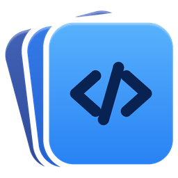
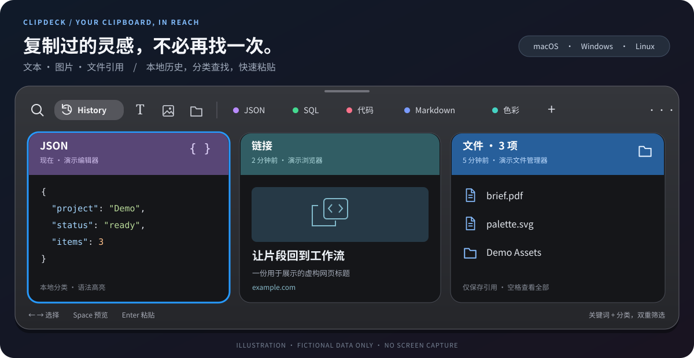
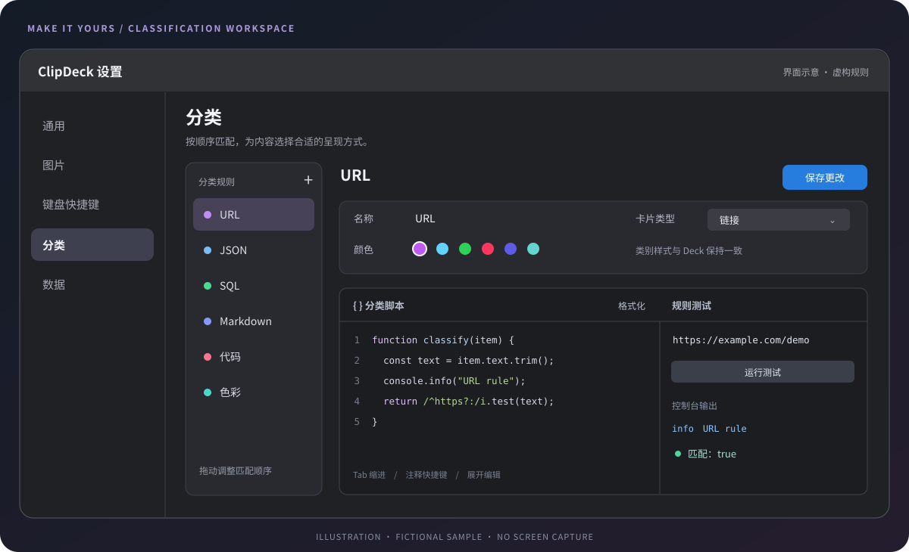
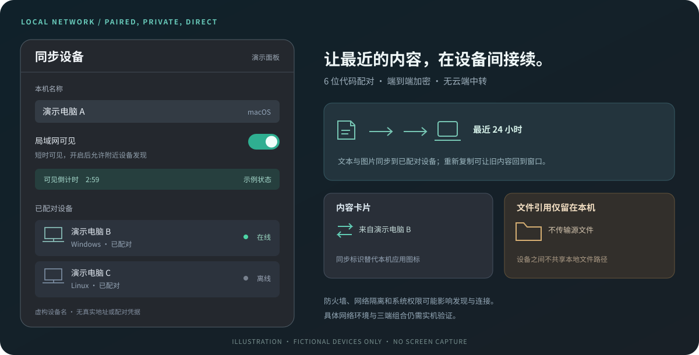

<p align="center">
  
</p>

<h1 align="center">ClipDeck</h1>

<p align="center">让复制的内容，随时回到工作流。<br>面向 macOS、Windows 与 Linux / UOS 的卡片式剪贴板历史工具。</p>

<p align="center">
  <a href="https://github.com/Ciel-Z/Clipdeck/releases">下载安装包</a> ·
  <a href="#平台与系统要求">平台与系统要求</a> ·
  <a href="#默认快捷键">默认快捷键</a> ·
  <a href="#从源码构建">从源码构建</a>
</p>



<p align="center"><sub>文档专用 SVG 渲染图，以当前界面结构重新绘制；所有文字、文件、设备与链接均为虚构样例，不是用户界面截图。各平台的窗口材质和细节以实际应用为准。</sub></p>

ClipDeck 把文本、富文本、图片和文件引用保存在本地历史中。呼出屏幕底部的横向 Deck，搜索、切换类型，随后复制或粘贴回当前工作。三个客户端共享分类规则、视觉资源和局域网同步协议，但保留各操作系统的剪贴板、窗口与权限实现。

> 本文按仓库当前代码整理，不代表旧安装包已经包含全部功能。项目持续开发中；重要内容请另行备份，跨设备和不同应用的粘贴兼容性仍需实机验证。

## 核心功能

###  Deck，找回刚才复制的内容

- 全局快捷键或菜单栏 / 托盘左键唤出，在鼠标所在显示器底部展示；右键打开应用菜单。
- 横向卡片浏览、方向键选择，顶部边缘可拖动调整高度；卡片按可用空间调整显示内容。
- 固定的 History、文本、图片、文件入口，与自定义分类分区展示。文本入口也包含已分类的文本。
- 关键词与当前类型 / 分类共同筛选。搜索从空变为有内容时先回到 History，之后可以继续切换分类。
- 双击或 Enter 粘贴；数字快捷键粘贴前九项；空格打开预览，Esc 分层退出。
- 复制卡片但不关闭 Deck，或粘贴并返回原应用；支持默认保留格式与强制纯文本模式。
- 按类型提供编辑、重命名、访问链接、旋转图片和删除等操作；文件引用不能按文本编辑。

### 内容按类型展示

| 内容 | 保存与展示 | 预览 / 操作 |
| --- | --- | --- |
| 文本与富文本 | 保存正文和可用的富文本表示；普通文本预览支持换行，富文本按适配后的样式展示 | 搜索、编辑、重命名、原格式或纯文本粘贴 |
| 代码、JSON、SQL | 本地分类与 highlight.js 语法高亮，不调用远端代码识别服务 | JSON 格式化、代码预览与编辑 |
| 链接 | 异步获取网页标题、站点图标与预览图；失败时降级显示 | 默认浏览器访问；后台串行队列管理元数据获取 |
| 图片 | 保存图片数据和旋转角度，预览按比例缩放并限制尺寸 | 棋盘格背景、旋转；设置容量 / 像素上限 |
| 色彩 | 识别 Hex、RGB / RGBA 等颜色内容 | 颜色填充卡片，查看或复制颜色值 |
| 文件与文件夹 | 一次复制多个文件保存为一张卡片；仅保存引用、名称、类型与图标，不备份源文件 | 单文件居中展示，多文件按高度显示列表，预览查看全部 |

文件卡片不会因为源文件暂时不可访问而从历史中消失。粘贴前检查可用性：全部不可用时保留 Deck，部分可用时提示确认后只粘贴可用文件。源文件被删除、移动或磁盘断开后，历史卡片不能替代原文件。

macOS 写回文件时保留 Finder 风格的文件引用 URL，避免文件退化成路径文本或应用图标；Windows 使用原生文件剪贴板格式，Linux 使用文件 URL / MIME 表示。各应用是否接受文件、文件类型或文件夹，由接收端决定。

### 可编辑的自动分类

预置 **URL、JSON、SQL、Markdown、代码、色彩**，按顺序运行 JavaScript 规则。内置与自建分类使用相同模型，可以混合排序、修改或恢复预设。

- 分类名称、六种预设色 / 自定义颜色、卡片显示类型均可调整。
- 分类规则采用 `function classify(item) { ... }`，编辑后可用样本验证。
- 脚本编辑支持高亮、格式化、Tab / Shift + Tab 缩进、注释及展开编辑。
- 测试结果展示匹配状态、异常与 `console.log/info/warn/error/debug` 输出。
- 文本卡片编辑保存后重新分类，标签随新内容更新。



<p align="center"><sub>分类编辑示意：左侧管理规则，右侧编辑与测试。macOS / Linux 使用公共 CodeMirror 6 WebView 编辑器，Windows 使用原生 QML 编辑器。</sub></p>

### 本地历史与性能

- SQLite 持久化，FTS5 全文搜索；macOS 使用 GRDB，Windows / Linux 共用 Qt 数据层。
- SHA-256 摘要与数据库索引用于近 24 小时内容去重；文件引用按路径集合判断重复，不读取文件正文计算摘要。
- 以最近一次复制时间计算保留期限，支持单项删除、清空、过期清理与缩短期限确认。
- 新复制内容的捕获、分类、落库与来源识别尽量在后台完成；先展示近期记录，再加载更多历史。
- 来源应用图标缓存与多尺寸资源复用，减少重复数据和重复读取。

## 局域网同步

在已配对的 macOS、Windows 与 Linux 设备之间直接同步历史，不需要账号或云端中转。

- 通过“局域网同步”菜单查看状态、暂停、立即同步或管理设备。
- 主动开启“局域网可见”后才应答发现请求，3 分钟后自动关闭。
- 6 位代码配对；错误尝试有次数限制，最多配对 8 台设备。
- 同步最近 24 小时的文本和图片；**文件 / 文件夹引用不跨设备同步**。旧内容再次复制或粘贴后可重新进入同步窗口。
- 删除仅作用于本机；同步记账用于防止已删除内容被同步回来。
- 收发时显示同步动画；其他设备传来的卡片以同步标识区别于本机来源应用。
- 配对使用 CPace（Ristretto255），已配对连接使用 Noise KK；加密由 libsodium 支持。



<p align="center"><sub>同步设备与传输范围示意。设备名称、网络信息、配对示例均为文档虚构数据，不含真实主机名、IP 或配对凭据。</sub></p>

三端都有同步实现与协议测试；这不等于所有网络、系统版本和三端组合均已完成实机互通验证。网络隔离、防火墙、VPN 和本地网络权限均可能影响发现或连接。协议与安全边界见 [局域网同步设计](docs/lan-sync-design.md)。

## 三端差异

| 项目 | macOS | Windows | Linux / UOS |
| --- | --- | --- | --- |
| 界面技术 | AppKit + SwiftUI | Qt 6 + QML，Win32 窗口与托盘 | Qt 5 Widgets，X11 剪贴板与窗口 |
| 剪贴板表示 | 文本 / RTF、图片、文件引用 URL | 文本 / HTML、图片、文件列表 | 文本 / HTML、图片、文件 URL |
| JavaScript 规则编辑器 | CodeMirror 6 + WKWebView | 原生 QML 编辑器 | CodeMirror 6 + Qt WebEngine |
| 自动粘贴前提 | 辅助功能授权；应用需以 `.app` 启动 | 目标进程权限不能高于 ClipDeck；管理员应用可能阻止注入 | 当前实现面向 X11；需要正常的桌面焦点与剪贴板环境 |
| 背景材质 | 系统原生材质，菜单可切换 | 自绘磨砂与 Win32 窗口适配，菜单可切换 | 材质 / 合成器适配，效果取决于桌面环境 |
| 本地设备身份保护 | 系统钥匙串 | DPAPI | 仅当前用户可读的文件 |
| 发布形式 | `.dmg`，可构建 Universal 应用 | x64 安装程序 / 构建目录 | AMD64 `.deb`，私有 Qt 运行库 |

## 默认快捷键

下表以 Deck 持有焦点、未在编辑器输入时为准。唤出、类型切换、快速粘贴和纯文本模式的组合可在设置中调整；已有用户配置优先于默认值。

| 操作 | macOS | Windows / Linux |
| --- | --- | --- |
| 呼出 / 收起 Deck | `Command + Shift + V` | `Alt + Shift + V` |
| 上 / 下一个分类 | `Command + ← / →` | `Ctrl + ← / →` |
| 选择相邻卡片 | `← / →` | `← / →` |
| 粘贴选中项 | `Enter` / 双击 | `Enter` / 双击 |
| 强制纯文本粘贴 | `Shift + Enter` | `Shift + Enter` |
| 快速粘贴前九项 | `Command + 1…9` | `Ctrl + 1…9` |
| 复制，保持 Deck 打开 | `Command + C` | `Ctrl + C` |
| 编辑 / 重命名 | `Command + E / R` | `Ctrl + E / R` |
| 浏览器访问链接 | `Command + O` | `Ctrl + O` |
| 预览 / 分层退出 | `Space` / `Esc` | `Space` / `Esc` |
| 删除选中卡片 | `Command + Backspace` | `Shift + Delete` |
| 打开设置 | `Command + ,` | `Ctrl + ,` |

不要将 Command 机械替换为 Ctrl 来推断全部快捷键：全局唤出和删除就是例外。正常的退格、复制粘贴、全选等输入行为在编辑区域按宿主编辑器处理。

## 平台与系统要求

- **macOS**：macOS 14+；Apple Silicon / Intel。未公证或本地签名构建可能触发系统安全提示；自动粘贴需要在“系统设置 → 隐私与安全性 → 辅助功能”中授权，更新应用后可能需要重新授权。
- **Windows**：Windows 10 / 11 x64。安装器支持当前用户安装、可选开机启动与桌面快捷方式；卸载默认保留历史。所有用户安装时的局域网防火墙配置见安装器脚本。
- **Linux / UOS**：当前打包目标是 UOS 20 AMD64 / X11，兼容基线为 Debian 10 / glibc 2.28。不要据此推断已支持 Wayland 或所有发行版。

下载入口：[GitHub Releases](https://github.com/Ciel-Z/Clipdeck/releases)。只安装对应平台的附件；仓库功能、安装包内容和实机验证进度可能不同。

## 从源码构建

### macOS

需要 Xcode 和兼容 Swift 6 的工具链。打开 `mac/ClipDeck.xcodeproj`，选择 `ClipDeck` / `My Mac` 运行，或：

```bash
cd mac
./scripts/run-debug.sh
swift test
```

通过 Swift Package Manager 获取 GRDB 与 swift-sodium 0.11。必须运行 `.app`，不要使用 `swift run ClipDeck` 替代应用 Bundle。打包脚本为 `mac/scripts/package-dmg.sh`；架构范围以构建配置为准。更多说明见 [macOS 运行指南](mac/RUNNING.md) 与 [更新说明](mac/CHANGELOG.md)。

### Windows

需要 Qt 6.5+（Core / Gui / Widgets / Network / Sql / Qml / Quick / Test）、MinGW-w64、CMake 3.21+、Ninja，以及支持 Ristretto255 的 libsodium 静态库。将工具链加入 `PATH`，替换下列路径：

```bash
cmake -S windows -B build-win -G Ninja -DCMAKE_BUILD_TYPE=Release -DCMAKE_PREFIX_PATH=<Qt>/mingw_64 -DSODIUM_ROOT=<libsodium-win64>
cmake --build build-win
```

产物为 `build-win/clipdeck.exe`。测试可执行文件包括 `core-tests`、`store-tests`、`deck-tests`、`platform-tests` 和 `sync-tests`，位于同一构建目录，需分别运行；当前 CMake 没有将它们注册到 CTest。平台剪贴板测试会写入系统剪贴板，执行前先退出 ClipDeck，避免测试数据进入历史。使用 Inno Setup 6 生成安装包：

```powershell
powershell -ExecutionPolicy Bypass -File windows\scripts\package-windows.ps1 -QtDir <Qt>\mingw_64 -SodiumRoot <libsodium-win64> -MinGWBin <MinGW>\bin
```

脚本使用 `windeployqt` 收集运行库，输出到 `windows/.build/release/installer/`。`windows/spike/` 是早期技术验证，不是当前完整客户端入口。

### Linux / UOS

在仓库根目录使用 Docker 构建 Debian 10 AMD64 环境：

```bash
bash linux/scripts/build-linux.sh
```

产物位于 `artifacts/linux/`。首次创建镜像需要网络，后续编译 / 打包阶段使用离线容器。安装、运行与内置自检说明见 [Linux README](linux/README.md)。

## 项目结构

| 目录 | 内容 |
| --- | --- |
| `mac/` | Swift / AppKit / SwiftUI 客户端、同步实现与测试 |
| `windows/` | Qt 6 / QML 客户端、Win32 集成、安装器与测试 |
| `linux/` | Qt 5 / X11 客户端、共享 C++ 历史 / 分类 / 同步逻辑、Debian 打包 |
| `script-editor/` | macOS / Linux 共用的 CodeMirror 6 Web 编辑器与桥接 |
| `shared/assets/` | 三端共用的 SVG、PNG、ICO 品牌资源 |
| `docs/images/` | README 的隐私安全 SVG 示意图与历史图片资源 |

修改公共编辑器后，在 `script-editor/` 执行 `npm ci`、`npm run check`、`npm run build`。构建后的 `dist/` 随客户端离线分发。

## 隐私与边界

- 历史默认存放在本机，不需要登录。代码识别、分类和语法高亮在本地执行。
- **链接元数据不是离线操作**：获取标题、图标和预览图会访问链接对应的网站，不应将“无云端中转”理解为应用完全不联网。
- 开启局域网同步后，最近内容会加密传输给已配对设备；本地历史本身不应被视作加密保险箱。
- 文件卡片只引用源文件，不复制文件内容，也不通过同步把文件传给其他设备。
- README 配图由手工 SVG 绘制，不使用真实截图、剪贴板内容、用户目录、主机名、IP 或访问令牌。配图约定见 [渲染图说明](docs/images/README.md)。

## License

使用 [MIT License](mac/LICENSE)。第三方依赖保留各自许可证；分发安装包前请核对相关许可要求。
