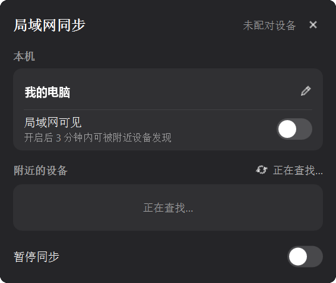
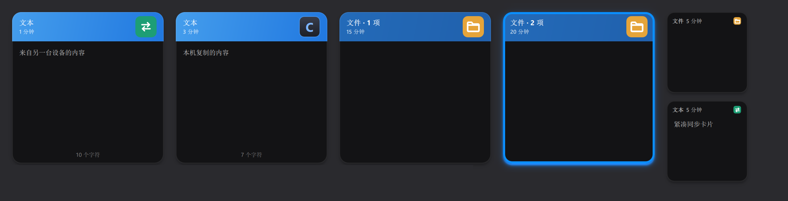

<p align="center">
  
</p>


<h1 align="center">ClipDeck</h1>

<p align="center">
  面向 macOS、Windows 与 Linux / UOS 的剪贴板历史工具，以横向卡片 Deck 让复制、查找和粘贴保持顺畅。
</p>

<p align="center">
  
</p>

<p align="center"><sub>真实应用界面渲染；卡片文字、链接、代码与颜色均为虚拟演示内容。</sub></p>

ClipDeck 提供原生 macOS 客户端、Qt 6 + QML Windows 客户端和 Qt Linux / UOS 客户端。它以屏幕底部的横向卡片 Deck 呈现最近复制的内容，并针对代码、链接和颜色等内容提供自动识别与专属展示。下文以 macOS 操作为主（Windows / Linux 上 Command 对应 Ctrl），Linux 快捷键与安装说明见 [Linux README](linux/README.md)，Windows 构建方式见下文“从源码运行”。

所有剪贴板历史、图片和分类配置均保存在本机，不依赖云端服务；需要多台电脑共用时，可以通过加密的局域网同步在已配对设备之间直接同步最近的内容。

## 软件特性

### 原生 Deck 体验

- 通过全局快捷键或左键点击菜单栏 / 托盘图标呼出 Deck
- 焦点离开 Deck 及其预览框、编辑框时自动收起
- 菜单栏 / 托盘菜单提供“背景模糊”开关，在磨砂透明与不透明深色背景间切换
- 在鼠标所在的显示器上弹出，支持多显示器
- 从屏幕底部调整高度，并记住上次使用的 Deck 高度
- 卡片随高度在紧凑模式和展开模式之间自适应切换
- 横向滚动浏览历史，键盘左右键快速切换选中内容
- 右键点击菜单栏图标打开设置或退出 ClipDeck

<p align="center">
  
</p>

<p align="center"><sub>紧凑高度下仍保留分类、语法高亮与横向浏览；展示内容均为虚拟数据。</sub></p>

### 快速查找与粘贴

- 输入时即时搜索，无需手动提交
- 同时搜索正文、标题和链接标题
- Deck 默认聚焦卡片，输入内容后自动进入搜索
- 按下 Command 显示最近 1–9 项序号，使用 Command + 数字快速粘贴
- 可配置全局唤出、上一个类型、下一个类型等快捷键
- 支持保留原格式粘贴与强制纯文本粘贴
- 粘贴完成后自动返回呼出 Deck 前持有焦点的应用

> 自动粘贴需要在“系统设置 → 隐私与安全性 → 辅助功能”中授权 ClipDeck。

### 本地剪贴板历史

- 保存文本、RTF 富文本和图片
- SQLite + GRDB 持久化，使用 FTS5 提供全文搜索
- 使用 SHA-256 和数据库索引合并近 24 小时内重复复制的内容
- 支持删除单项、清空历史和历史过期清理
- 按最近一次复制时间计算保留期限，缩短期限时提示确认
- 提供图片文件大小与最大像素保护
- 应用退出并重新启动后仍可恢复历史记录

### 局域网同步

在同一局域网内的 Mac、Windows 与 Linux 电脑之间直接同步剪贴板历史，不经过任何云端服务器。

- 按需发现：只有打开“局域网可见”的设备才会被搜索到，3 分钟后自动关闭；附近设备以“主机名 · IP”显示
- 配对：一台设备显示 6 位配对码，另一台输入后完成配对，错误 5 次自动终止；最多配对 8 台设备
- 同步范围：最近 24 小时内的文本与图片（文件卡片只在本机保存）；更早的内容再次复制或粘贴后即重新进入同步
- 删除只影响本机，已删除的内容不会被其他设备同步回来
- 托盘 / 菜单栏“局域网同步”子菜单提供状态、局域网可见（带倒计时）、暂停同步、立即同步和“同步设备…”面板
- Deck 左上角仅在收发内容时显示灰色加载动画，同步结束后淡出
- 来自其他设备的卡片以青绿色同步图标代替应用图标，来源应用名称仍保留在卡片信息中
- 多网卡：只使用私有 IPv4 地址，自动排除 VPN 与虚拟网卡；网络切换或唤醒后自动重连

<p align="center">
  
</p>

<p align="center"><sub>Windows 上的“同步设备”面板：编辑本机名称、开关局域网可见、搜索并配对附近的设备。</sub></p>

<p align="center">
  
</p>

<p align="center"><sub>青绿色双向箭头表示来自其他设备的卡片，琥珀色文件夹表示文件卡片，二者与应用图标同尺寸、无阴影；展示内容均为虚拟数据。</sub></p>

同步协议与加密设计见 [docs/lan-sync-design.md](docs/lan-sync-design.md)。

### 自动分类

内置以下可编辑分类：

- URL
- JSON
- SQL
- Markdown
- 代码
- 色彩

分类按顺序匹配，支持拖动排序。所有内置分类与用户创建的分类使用相同的数据模型，均可修改名称、颜色、卡片类型和 JavaScript 分类规则，也可以恢复为系统预设。

- 颜色：6 种预设色或自定义颜色，分类列表与 Deck 分类栏显示同一圆点颜色
- 卡片类型：纯文本、代码（自动识别语言并着色）、链接、色彩
- 内置规则在识别率与误判之间做了平衡，例如带句号的英文句子不会被当作 SQL，单个数字或空对象不会被当作 JSON
- 编辑文本卡片并保存后会重新分类，内容不再匹配时标签随之更新

<p align="center">
  
</p>

<p align="center"><sub>内置分类和自建分类可混合排序；示例中的“工作片段”是使用虚拟 JavaScript 规则创建的自定义分类。</sub></p>

分类管理器提供：

- 分类新增、编辑、删除和排序
- JavaScript 规则语法高亮与格式化
- 公共 CodeMirror 6 编辑器，支持补全、自动缩进、Tab 缩进与注释快捷键；Windows 使用原生 QML 编辑器，提供同样的高亮与快捷键
- 滚动时显示半透明滚动条；“展开编辑”在独立窗口中同时查看规则、测试与可用字段
- 测试文本和规则即时验证
- 测试结果显示 `console.log/info/warn/error/debug` 输出
- 删除前确认
- 系统预制分类一键还原

### 代码识别与语法高亮

ClipDeck 使用可支持自定义的分类检测，并本地内置的 highlight.js 可渲染语法高亮。

当前检测与高亮覆盖：

- Swift、Objective-C
- Java、Kotlin
- JavaScript、TypeScript
- Python、Ruby、PHP、Lua
- C、C++、C#
- Go、Rust
- Shell
- HTML、XML、CSS

代码卡片会直接显示识别出的语言。编辑 JSON、SQL 和已识别代码时，同样提供对应语法高亮。

### 内容专属展示

- 链接：复制后异步获取网页标题、站点图标、预览图和域名，失败时自动降级
- 图片：透明棋盘背景、完整缩放预览，支持向左或向右旋转；macOS 预览框按宽高比动态调整，并限制最大尺寸
- macOS 图片复制：兼容同时包含图片数据与文件 URL、仅图片文件 URL，以及 JPEG、HEIC、WebP 等图片表示
- 颜色：识别 Hex、RGB 和 RGBA，并以实际颜色填充卡片
- 文本：支持直接编辑、重命名、复制、预览和删除
- 文件卡片的来源位置显示琥珀色文件夹图标，与应用图标的尺寸和圆角保持一致
- 图片与颜色卡片采用沉浸式头部，不遮挡主要内容
- macOS 文件/文件夹：按一次复制生成单文件或多文件卡片，只保存路径、名称、类型和图标；支持搜索与原生文件 URL 粘贴，不备份文件内容
- macOS 文件卡片始终展示，粘贴时后台检查可访问性；失败时保留 Deck 和原剪贴板，部分可用时由用户确认后粘贴

macOS 顶栏以 History、文本、图片、文件四个固定图标入口导航，分隔线右侧为可横向滚动的自定义分类。文本入口包含已分类文本；搜索关键词与当前入口共同限定结果。

### 卡片操作

- 双击卡片直接粘贴
- 右键菜单支持粘贴、纯文本粘贴、复制、编辑、重命名、预览和删除
- Command + C 或右键“复制”将卡片写入剪贴板并保持 Deck 打开；复制与粘贴都会把卡片移到最前，并视为一次新的复制参与同步
- Command + E 编辑文本
- Command + R 重命名标题
- Command + O 使用默认浏览器访问链接，Command + Delete 删除选中卡片
- 空格键显示悬浮预览，不关闭 Deck
- 切换卡片或完成粘贴时自动关闭预览

## 系统要求

- macOS 14 或更高版本
- Apple Silicon 或 Intel Mac
- Xcode 16 或兼容 Swift 6 的开发环境（从源码构建时）
- Windows：Windows 10 / 11 x64；从源码构建需要 Qt 6.5 或更高版本（已在 Qt 6.12 上验证）、MinGW-w64、CMake 3.21+、Ninja，以及 libsodium 1.0.18 或更高版本（局域网同步，静态链接）
- Windows 安装包：默认按当前用户安装，可选桌面快捷方式与开机启动，卸载时保留历史记录；生成方式见下文
- Linux：UOS 20 AMD64 / X11，构建与离线安装方式见 [Linux README](linux/README.md)

## 从源码运行

克隆仓库后，可使用 Xcode 打开 `mac/ClipDeck.xcodeproj`，选择 `ClipDeck` Scheme 后直接运行。

也可以使用命令行：

```bash
cd mac
swift build
swift run ClipDeck
```

运行测试：

```bash
cd mac
swift test
```

macOS 通过 Swift Package Manager 获取 [swift-sodium](https://github.com/jedisct1/swift-sodium) 中的 libsodium，用于局域网同步加密。

Windows 使用 Qt 自带或 WinLibs 的 MinGW 工具链构建（将 Qt、MinGW、CMake 与 Ninja 加入 `PATH`）。局域网同步需要 libsodium 官方 MinGW 构建（`libsodium-1.0.20-mingw.tar.gz`，解压后取 `libsodium-win64`）：

```bash
cmake -S windows -B build-win -G Ninja -DCMAKE_BUILD_TYPE=Release -DCMAKE_PREFIX_PATH=<Qt 安装目录>/mingw_64 -DSODIUM_ROOT=<libsodium-win64 目录>
cmake --build build-win
```

构建产物为 `build-win/clipdeck.exe`，测试为同目录下的 `core-tests`、`store-tests`、`deck-tests`、`platform-tests` 与 `sync-tests`。运行 `platform-tests` 前请先退出 ClipDeck，否则测试写入的剪贴板内容会被记录进历史。

生成 Windows 安装包需要 [Inno Setup 6](https://jrsoftware.org/isinfo.php)。脚本会以 Release 构建、用 `windeployqt` 收集 Qt 运行库，再生成 `windows/.build/release/installer/ClipDeck-<版本>-windows-x64-setup.exe`：

```powershell
powershell -ExecutionPolicy Bypass -File windows\scripts\package-windows.ps1 -QtDir <Qt 安装目录>\mingw_64 -SodiumRoot <libsodium-win64 目录> -MinGWBin <MinGW>\bin
```

安装包默认按当前用户安装（无需管理员权限）。在安装向导中选择“为所有用户安装”时，还会为局域网同步添加专用 / 域网络的防火墙放行规则。

Linux 在仓库根目录通过 Docker 构建：

```bash
bash linux/scripts/build-linux.sh
```

## 公共目录

- `mac/`：Swift / AppKit / SwiftUI 客户端与测试
- `windows/`：Qt 6 + QML 客户端（Win32 剪贴板监听、托盘、全局快捷键、DWM 磨砂背景）与测试
- `linux/`：Qt 客户端、X11 剪贴板读取、后台历史处理与 Debian 打包脚本；Windows 复用其中的 SQLite 数据层与默认分类规则
- `script-editor/`：两端共用的 CodeMirror 6 编辑器，通过 WebView 桥接宿主
- `shared/assets/`：三端共用的图标（菜单栏 / 托盘 SVG、应用图标 PNG、Windows ICO），均由 `generate_icons.py` 从同一设计生成

编辑公共编辑器后，在 `script-editor/` 中执行 `npm ci`、`npm run check` 和 `npm run build`；生成的 `dist/` 随客户端离线打包。

## 技术实现

- Swift 6
- AppKit + SwiftUI
- SQLite + GRDB.swift + FTS5
- JavaScriptCore
- highlight.js（随应用本地打包，不从网络加载）
- Carbon 全局快捷键
- Windows：Qt 6 + QML、Win32 / DWM API，QJSEngine 运行分类规则与 highlight.js
- 局域网同步：libsodium（静态链接）；配对使用 CPace（ristretto255），日常连接使用 Noise KK（X25519 + ChaCha20-Poly1305 + BLAKE2b），设备之间以混合逻辑时钟合并修改；Windows 与 Linux 共用一份 C++ 实现，macOS 使用 Swift + Network.framework 实现同一协议

macOS 运行说明见 [RUNNING.md](mac/RUNNING.md)，更新说明见 [CHANGELOG.md](mac/CHANGELOG.md)。Linux 使用独立的 X11 读取线程与后台历史处理队列，在界面线程之外完成剪贴板读取、持久化和来源应用识别，并按需加载完整卡片内容。

## 隐私

ClipDeck 的历史内容默认仅保存在本机数据库中。应用不会上传剪贴板内容，也不会为语法高亮或代码识别请求外部服务。获取链接标题和站点图标时，ClipDeck 会访问该链接对应的网站。

局域网同步只在已配对的设备之间直接传输，全部内容经端到端加密。发现设备用的 UDP 组播包不含主机名或任何剪贴板内容，且只在局域网可见期间才会应答；设备私钥保存在系统钥匙串（macOS）、DPAPI 加密文件（Windows）或仅本用户可读的文件（Linux）中。

## 当前状态

项目仍在持续开发中。建议在日常使用前保留重要内容的独立副本，并通过 Issue 反馈无法识别的代码片段、网站元数据兼容问题或交互异常。

局域网同步为新功能：Windows 端已通过协议与端到端测试，macOS 与 Linux 端的实现尚待在实机上完成构建和跨设备验证。

## License

macOS 客户端使用 [MIT License](mac/LICENSE) 开源。
