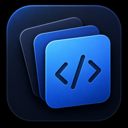
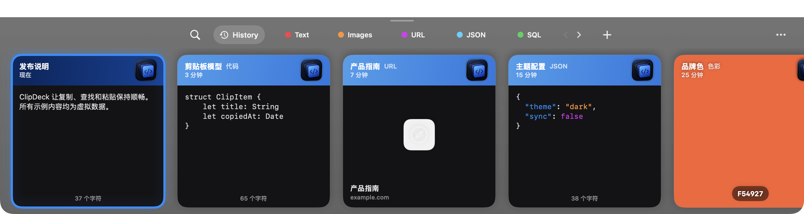
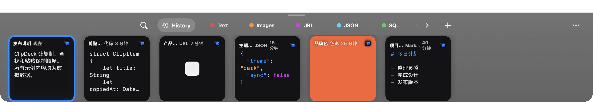
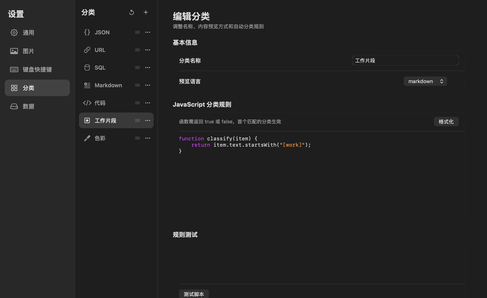

<p align="center">
  
</p>


<h1 align="center">ClipDeck</h1>

<p align="center">
  原生 macOS 剪贴板历史工具，以横向卡片 Deck 让复制、查找和粘贴保持顺畅。
</p>

<p align="center">
  
</p>

<p align="center"><sub>真实应用界面渲染；卡片文字、链接、代码与颜色均为虚拟演示内容。</sub></p>

ClipDeck 是一款原生 macOS 剪贴板历史工具。它以屏幕底部的横向卡片 Deck 呈现最近复制的内容，在保留快速搜索、预览和键盘粘贴体验的同时，针对代码、链接和颜色等内容提供自动识别与专属展示。

所有剪贴板历史、图片和分类配置均保存在本机，不依赖云端服务。

## 软件特性

### 原生 Deck 体验

- 通过全局快捷键或左键点击菜单栏图标呼出 Deck
- 在鼠标所在的显示器上弹出，支持多显示器
- 从屏幕底部调整高度，并记住上次使用的 Deck 高度
- 卡片随高度在紧凑模式和展开模式之间自适应切换
- 横向滚动浏览历史，键盘左右键快速切换选中内容
- 右键点击菜单栏图标打开设置或退出 ClipDeck

<p align="center">
  
</p>

<p align="center"><sub>紧凑高度下仍保留分类、语法高亮与横向浏览；展示内容均为虚拟数据。</sub></p>

### 快速查找与粘贴

- 输入时即时搜索，无需手动提交
- 同时搜索正文、标题和链接标题
- Deck 默认聚焦卡片，输入内容后自动进入搜索
- 按下 Command 显示最近 1–9 项序号，使用 Command + 数字快速粘贴
- 可配置全局唤出、上一个类型、下一个类型等快捷键
- 支持保留原格式粘贴与强制纯文本粘贴
- 粘贴完成后自动返回呼出 Deck 前持有焦点的应用

> 自动粘贴需要在“系统设置 → 隐私与安全性 → 辅助功能”中授权 ClipDeck。

### 本地剪贴板历史

- 保存文本、RTF 富文本和图片
- SQLite + GRDB 持久化，使用 FTS5 提供全文搜索
- 自动合并短时间内重复复制的内容
- 支持删除单项、清空历史和历史过期清理
- 可输入历史保留天数
- 提供图片文件大小与最大像素保护
- 应用退出并重新启动后仍可恢复历史记录

### 自动分类

内置以下可编辑分类：

- URL
- JSON
- SQL
- Markdown
- 代码
- 色彩

分类按顺序匹配，支持拖动排序。所有内置分类与用户创建的分类使用相同的数据模型，均可修改名称、图标、预览语言和 JavaScript 分类规则，也可以恢复为系统预设。

<p align="center">
  
</p>

<p align="center"><sub>内置分类和自建分类可混合排序；示例中的“工作片段”是使用虚拟 JavaScript 规则创建的自定义分类。</sub></p>

分类管理器提供：

- 分类新增、编辑、删除和排序
- JavaScript 规则语法高亮与格式化
- 测试文本和规则即时验证
- 删除前确认
- 系统预制分类一键还原

### 代码识别与语法高亮

ClipDeck 使用可支持自定义的分类检测，并本地内置的 highlight.js 可渲染语法高亮。

当前检测与高亮覆盖：

- Swift、Objective-C
- Java、Kotlin
- JavaScript、TypeScript
- Python、Ruby、PHP、Lua
- C、C++、C#
- Go、Rust
- Shell
- HTML、XML、CSS

代码卡片会直接显示识别出的语言。编辑 JSON、SQL 和已识别代码时，同样提供对应语法高亮。

### 内容专属展示

- 链接：异步获取网页标题、站点图标和域名，失败时自动降级
- 图片：透明棋盘背景、完整缩放预览，支持向左或向右旋转
- 颜色：识别 Hex、RGB 和 RGBA，并以实际颜色填充卡片
- 文本：支持直接编辑、重命名、复制、预览和删除
- 图片与颜色卡片采用沉浸式头部，不遮挡主要内容

### 卡片操作

- 双击卡片直接粘贴
- 右键菜单支持粘贴、纯文本粘贴、复制、编辑、重命名、预览和删除
- Command + E 编辑文本
- Command + R 重命名标题
- 空格键显示悬浮预览，不关闭 Deck
- 切换卡片或完成粘贴时自动关闭预览

## 系统要求

- macOS 14 或更高版本
- Apple Silicon 或 Intel Mac
- Xcode 16 或兼容 Swift 6 的开发环境（从源码构建时）

## 从源码运行

克隆仓库后，可使用 Xcode 打开 `ClipDeck.xcodeproj`，选择 `ClipDeck` Scheme 后直接运行。

也可以使用命令行：

```bash
swift build
swift run ClipDeck
```

运行测试：

```bash
swift test
```

## 技术实现

- Swift 6
- AppKit + SwiftUI
- SQLite + GRDB.swift + FTS5
- JavaScriptCore
- highlight.js（随应用本地打包，不从网络加载）
- Carbon 全局快捷键

更详细的实现约束与开发说明见 [DEVELOPMENT.md](DEVELOPMENT.md)。

## 隐私

ClipDeck 的历史内容默认仅保存在本机数据库中。应用不会上传剪贴板内容，也不会为语法高亮或代码识别请求外部服务。获取链接标题和站点图标时，ClipDeck 会访问该链接对应的网站。

## 当前状态

项目仍在持续开发中。建议在日常使用前保留重要内容的独立副本，并通过 Issue 反馈无法识别的代码片段、网站元数据兼容问题或交互异常。

## License

ClipDeck 使用 [MIT License](LICENSE) 开源。
